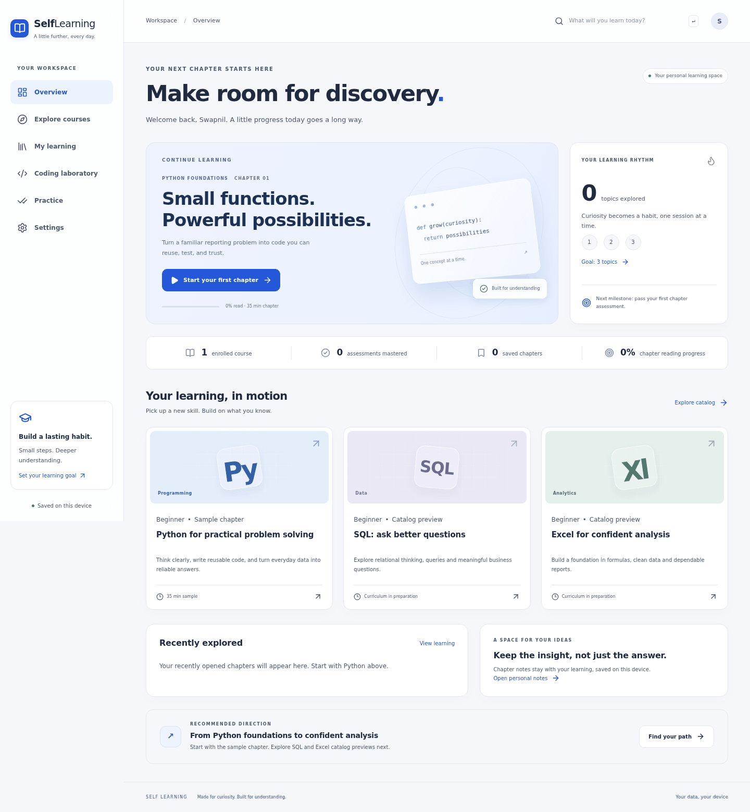

# Self Learning

A web-first, local-first learning workspace with eight screens, a structured textbook reader, original Python sample chapter, CodeMirror laboratory and actual Pyodide worker execution. This is the frontend foundation, **not a finished multi-course curriculum**. Four additional catalog entries are explicitly labeled previews.

## Run

Requires Node 24 and npm. Clone the implementation branch, then run:

```sh
git clone --branch codex/self-learning-foundation https://github.com/Swapnild007/Self_learning.git
cd Self_learning
npm ci
npm run dev -- --host 127.0.0.1
```

For a phone on the same trusted network, run `npm run dev`, then open the computer's LAN IP and port 5173 on the phone. No public deployment is needed. Clipboard support may require HTTPS or localhost; the UI reports unavailable clipboard access. Company network policy can prevent LAN access. Browser emulation does not verify a physical Android phone.

```sh
npm test
npm run build
npx playwright install --with-deps chromium
npm run test:e2e
```

## Structure

- `src/pages/`: dashboard, catalog, overview, reader, lab, practice, my learning, settings; lazy loaded by route.
- `src/content/`: typed schema, original sample and honest catalog previews.
- `src/components/`: reusable semantic controls, Radix dialogs and CodeMirror editor.
- `src/store.tsx`: versioned local storage, validation and controlled updates.
- `src/python.worker.ts`, `src/usePython.ts`: real WebAssembly Python, capped output, timeout and cancellation.
- `tests/e2e/`: Chromium desktop and Android-sized viewport flows, actual runtime tests, accessibility and screenshots.
- `docs/`: authoring guide, design decisions, verification report and screen captures.

Hash routing permits static hosting without rewrite rules. The application assumes deployment at an origin root for Python assets; subdirectory deployments need a configurable base URL before release. There is no auth server, cloud synchronization, analytics tracking, accreditation, certificate or public deployment workflow.

## Important boundaries

Python runs in a worker to keep the UI responsive. Stop terminates it; a 120-second wall-clock timeout includes initial runtime loading. Development and preview include COOP/COEP headers; in a secure, isolated browser context, a shared interrupt signal lets Python unwind before the worker is terminated after 250 ms. Other hosts fall back to worker termination. Preserve these headers on a future host to retain cooperative interruption. It is **not a secure executor for hostile scripts**: Python can reach worker/browser APIs. Do not run untrusted code or paste credentials. Worker termination does not guarantee memory safety. Output is capped at 50,000 characters. Desktop GUI libraries, subprocesses and input prompts are unsupported. Only standard-library sample code is supported in this foundation. Network-dependent package installation is not exposed.

Assessment tests check function behavior with several inputs. They are local pedagogical checks, not adversarial exam proctoring. Reading acknowledgements record self-reported progress; only a 100% assessment score shows mastery. Local data is browser/origin-specific. Export/import provides manual backup and transfer; imports replace existing data. Avoid private customer data in notes.

See [authoring](docs/CONTENT_AUTHORING.md), [design and attribution](docs/DESIGN_SYSTEM.md), and [verification](docs/VERIFICATION.md).

## Screens



The review includes captures of all eight desktop and mobile web screens. Use the catalog to open the original Python sample, then the reader toolbar for bookmarks, notes and typography. Use Practice for verified local assessments. The other four courses remain explicit previews.
